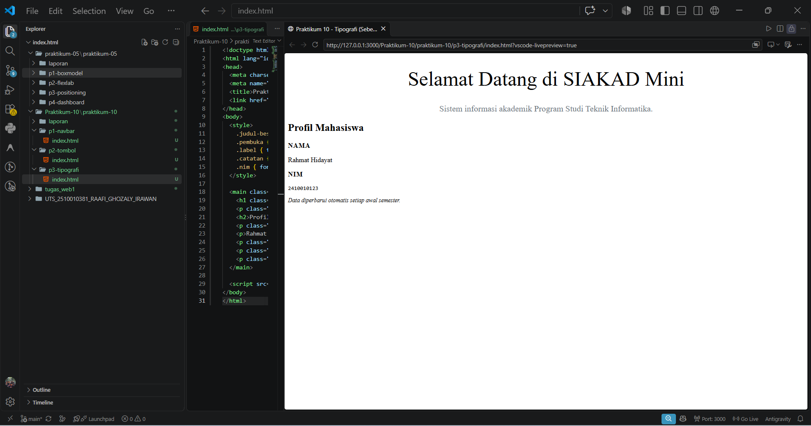
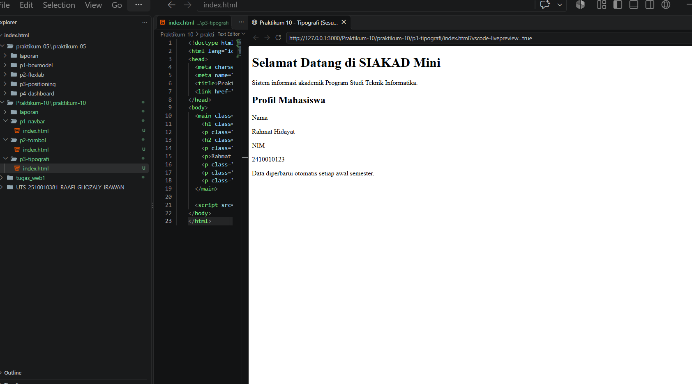

# Laporan Praktikum Pertemuan 10 Pemrograman Web 1
#### Nama : Raafi Ghozaly Irawan
#### NIM : 2510010381
#### Kelas : 3B TI BJB

## Percobaan 1 Navbar 
| No | Eksperimen | Pengamatan |
|---|---|---|
| 1 | Class `#menuLab` & `aria-expanded` saat menu dibuka | Waktu dibuka, `#menuLab` dapat class `collapse show`, tombol jadi `aria-expanded="true"`. Ditutup balik ke `collapse` dan `"false"`. |
| 2 | Hamburger di 1000 px pakai `navbar-expand-lg` | Hamburger gak muncul, menu tetap horizontal karena 1000 px masih ≥ 992 px (breakpoint lg). |
| 3 | Perilaku 800 px: `-md` / tanpa sufiks / tanpa expand | `-md`: menu horizontal (800 ≥ 768). `navbar-expand` tanpa sufiks: selalu horizontal. Tanpa class expand: selalu terlipat. |
| 4 | `data-bs-target` salah ketik | Tombol gak buka apa-apa karena id yang dituju (`"menu"`) gak ada. Console juga gak selalu kasih error. |
| 5 | Tanpa JS bundle | Tampilan tetap normal (CSS jalan), tapi collapse & dropdown gak fungsi karena JS-nya gak ke-load. |
| 6 | `bg-dark` tanpa vs dengan `data-bs-theme="dark"` | Tanpa `data-bs-theme="dark"`, background gelap tapi teks ikut gelap → susah dibaca. Setelah ditambah, teks & ikon jadi terang. |
| 7 | `sticky-top` vs `fixed-top` | `sticky-top` nempel pas di-scroll, judul awal gak ketutup. `fixed-top` bikin navbar keluar flow, judul "Konten halaman" ketutup. |

## Percobaan 2 Tombol
| No | Eksperimen | Pengamatan |
|---|---|---|
| 1 | Kelompok Batal-Simpan di 375 px & 1000 px | Di 375 px tombol numpuk vertikal (`d-grid`). Di 1000 px jadi sejajar horizontal rata kanan (`d-md-flex justify-content-md-end`). |
| 2 | Elemen disabled yang masih bisa di-Tab | `<button disabled>` di-skip Tab. `<a href="#" class="disabled">` masih bisa difokus & diaktifkan Enter. `<a>` tanpa `href` + `aria-disabled="true"` gak bisa difokus sama sekali. |
| 3 | Kontras `text-bg-warning` vs `bg-warning` | `text-bg-warning` → teks gelap di atas kuning, kontras oke (lolos AA). `bg-warning` doang → teks putih, kontras jelek. |
| 4 | Nama tombol Notifikasi dengan/tanpa `visually-hidden` | Pakai `visually-hidden`: screen reader baca "Notifikasi 3 notifikasi belum dibaca". Tanpa itu cuma kebaca "Notifikasi 3". |

## Percobaan 3 Tipografi
| Class lama | Utilitas pengganti (isi) | Tampilan sama? (ya/tidak) |
|---|---|---|
| `.judul-besar` | `display-5 text-center` | ya |
| `.pembuka` | `lead text-body-secondary text-center` | ya |
| `.label` | `text-uppercase fw-bold small` (`letter-spacing` diabaikan) | ya |
| `.catatan` | `small fst-italic` | ya |
| `.nim` | `font-monospace` | ya |
| Temuan Lighthouse untuk `<h4>` | Skor Accessibility 94; heading loncat dari `h1` ke `h4`. Solusi: tetap pakai `<h2>` tapi dikasih `class="h4"`. | - |

Sebelum Sesudah

## Jawaban Pertanyaan Analisis
1. Waktu tombol hamburger diklik, JS Bootstrap ngubah DOM — nambah/hapus class `show` di `#menuLab` dan update `aria-expanded` jadi `"true"` atau `"false"` di tombol toggler. Ini sama kayak konsep manipulasi DOM yang diajarin (ubah class & atribut lewat event klik).
2. Navbar tetap keliatan karena tampilannya diatur CSS Bootstrap. Tapi interaksi buka-tutup collapse & dropdown butuh JS Bootstrap (`bootstrap.bundle.min.js`) buat nangani klik dan manipulasi DOM-nya.
3. Tag `<a>` yang punya `href` walaupun dikasih class `disabled` secara keyboard & screen reader tetap bisa difokus dan ditekan Enter — ini bahaya karena bisa nge-trigger navigasi yang gak diinginkan.
4. Pertama, heading harus urut (`h1` → `h2` dst.) biar screen reader dan audit aksesibilitas gak bingung. Kedua, kalau mau heading keliatan kecil kayak h4 tapi secara struktur tetap h2, tinggal pakai class `h4`.

## Kesimpulan
Dari praktikum ini, komponen responsif dan utilitas Bootstrap 5.3 cukup ngebantu buat ngatur layout, tombol, badge, dan tipografi tanpa nulis banyak CSS sendiri. Selain itu, penting juga ngecek atribut aksesibilitas, status elemen disabled, dan urutan heading biar UI-nya bisa diakses semua orang.