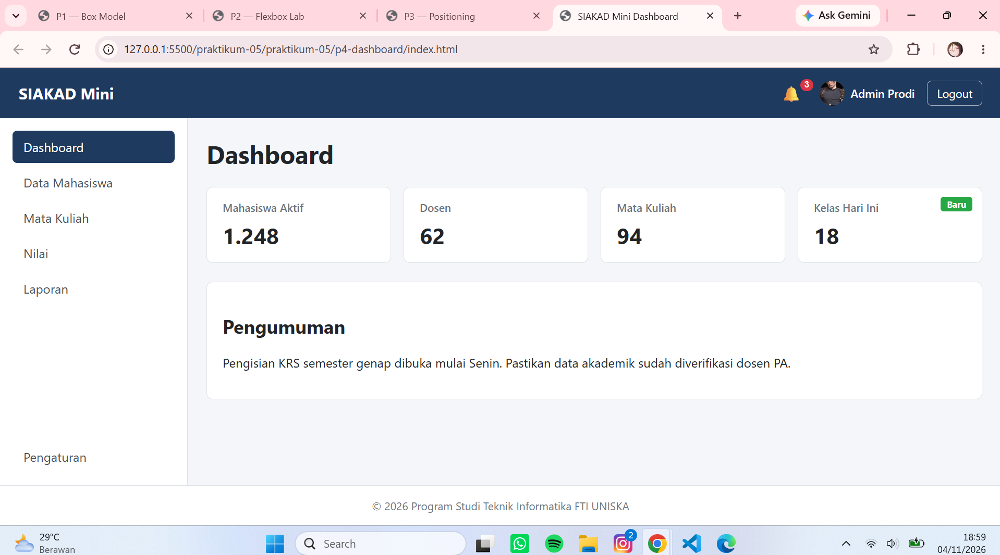
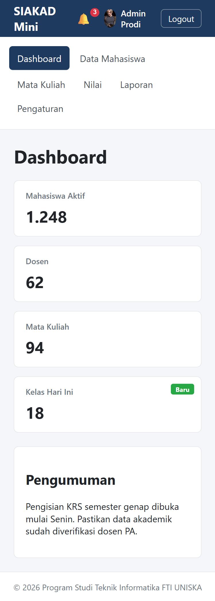

# Laporan Praktikum Pertemuan 5 Pemrograman Web 1

**Nama**  : Raafi Ghozaly Irawan  
**NIM**   : 2510010381  
**Kelas** : 3B TI BJB  

## Percobaan 1 Box Model

| No | Kondisi | Lebar Kotak A (px) | Lebar Kotak B (px) |
|---|---|---|---|
| 1 | padding 20px | 350 | 300 |
| 2 | padding 40px | 390 | 300 |

| No | Kondisi | Jarak judul-paragraf (px) |
|---|---|---|
| 3 | Block biasa | 30 |
| 4 | Di dalam flex column | 50 |

| No | Kondisi .menu a | Latar menimpa teks lain? (ya/tidak) |
|---|---|---|
| 5 | inline (bawaan) | Ya |
| 6 | inline-block | Tidak |

## Percobaan 2 Flexbox Lab

| No | Properti dan Nilai | Pengamatan |
|---|---|---|
| 1 | `display: flex` | Elemen item berjajar secara horizontal ke samping dan tingginya otomatis sama rata (stretch). |
| 2 | `justify-content: space-between` | Item A di ujung kiri, C di ujung kanan, dan B berada di tengah mengisi ruang sisa. |
| 2b | `justify-content: space-evenly` | Seluruh jarak celah antaritem dan tepi container berukuran sama rata. |
| 3 | `align-items: stretch` vs `center` | `stretch` membuat tinggi item memenuhi container, sedangkan `center` membuat item setinggi isinya dan berada di tengah secara vertikal. |
| 4 | `flex-direction: column` + `justify-content: center` | Item tersusun secara vertikal ke bawah dan terkumpul tepat di tengah-tengah arah vertikal. |
| 5 | 8 item x 200 px, `nowrap` vs `wrap` | Pada `nowrap`, 8 item dipaksa muat dalam 1 baris sehingga menyusut; pada `wrap`, item tetap 200px dan sisanya turun ke baris baru. |
| 6 | `.b { flex-grow: 1 }` | Item B membesar dan menyerap seluruh ruang kosong sisa di dalam container. |
| 7 | `flex: 0 0 200px`, `1`, `2` | Lebar A = 200px, sisa ruang 800px dibagi rasio 1:2 sehingga B ≈ 266.7px dan C ≈ 533.3px. |
| 8 | `.c { order: -1 }` | Item C berpindah tampilan ke posisi paling kiri tanpa mengubah urutan elemen di kode HTML. |
| 9 | `.c { margin-left: auto }` | Item C terdorong jauh ke ujung kanan karena margin otomatis menyerap seluruh sisa ruang horizontal. |
| 10 | `gap: 24px` | Muncul jarak celah sebesar 24px secara rapi di antara tiap item tanpa mempengaruhi tepi outer container. |

## Percobaan 3 Positioning

| No | Eksperimen | Pengamatan |
|---|---|---|
| 1 | Header `sticky` saat digulir | Header mengalir bersama dokumen dan otomatis menempel di tepi atas viewport ketika digulir tanpa menutupi paragraf pertama. |
| 2a | Header `fixed` tanpa `padding-top` body | Header melayang keluar dari aliran dokumen sehingga judul h1 dan paragraf pertama tertutup di belakang header. |
| 2b | Header `fixed` dengan `padding-top: 64px` | Konten paragraf terdorong ke bawah sejauh 64px sehingga seluruh teks kembali terlihat jelas di bawah header. |
| 3 | `.notif` tanpa `position: relative` | Badge merah melompat menempel ke pojok kanan atas elemen header/halaman, bukan lagi pada tombol lonceng. |
| 4 | `.lapis-1` z-index 3, lalu `lapis-2` z-index 5 | Elemen lapis-2 dengan z-index 5 tampil di urutan paling depan menutupi lapis-1 (z-index 3) dan lapis-3. |
| 5 | Header z-index 1 | Elemen lapis-1 (z-index 3) dan lapis-2 (z-index 5) menutupi header saat digulir melewati header. |
| 6 | Tombol Bantuan di layar 375 px | Tombol Bantuan tetap menempel di pojok kanan bawah layar viewport pada semua ukuran layar saat digulir. |

## Percobaan 4 Dashboard

  
  

## Jawaban Pertanyaan Analisis

1. **Mengapa `box-sizing: border-box` ditulis di awal stylesheet proyek?**
Agar perhitungan lebar dan tinggi elemen menjadi lebih konsisten. Dengan aturan ini, penambahan padding atau border sudah tercakup di dalam ukuran total elemen, sehingga elemen tidak mengalami pembesaran di luar dimensi yang telah ditentukan.
2. **Jelaskan mengapa item terkumpul di tengah secara vertikal pada Percobaan 2 Eksperimen 4!**
Karena penggunaan `flex-direction: column` mengubah arah sumbu utama (*main axis*) menjadi vertikal. Ketika properti `justify-content: center` diterapkan, elemen-elemen di dalamnya otomatis terpusat sepanjang sumbu vertikal tersebut.
3. **Perhitungan lebar B dan C pada eksperimen 7 & perubahan jika `.b` memakai `flex: 1 1 auto`:**
Total lebar kontainer adalah 1000px dikurangi kotak A (200px), menyisakan 800px. Dengan rasio 1:2, sisa ruang dibagi menjadi tiga bagian sehingga B berukuran sekitar 266.7px dan C sekitar 533.3px. Jika `.b` diubah menjadi `flex: 1 1 auto`, item tersebut akan menyesuaikan dengan lebar konten aslinya terlebih dahulu sebelum sisa ruang didistribusikan.
4. **Mengapa pada Percobaan 3 Eksperimen 3 badge menempel ke header, bukan ke pojok halaman?**
Elemen dengan posisi `absolute` akan mencari elemen pembungkus terdekat yang memiliki posisi non-static. Ketika `position: relative` dihilangkan, acuan posisi badge berpindah ke elemen pembungkus di atasnya yang memiliki properti `position: sticky`.
5. **Bandingkan `sticky` dan `fixed` untuk navbar dashboard!**
Penggunaan `position: sticky` lebih disarankan karena mengikuti alur dokumen normal, sehingga kita tidak perlu menambahkan padding manual pada elemen `body` untuk menghindari konten tertutup navbar.
6. **Fungsi `flex: 1` pada `.wrapper` dan dampaknya jika dihapus:**
Properti ini berfungsi untuk meregangkan area kontainer utama agar mengisi sisa ruang vertikal antara navbar dan footer. Jika dihapus, kontainer hanya akan mengikuti tinggi kontennya, yang mengakibatkan footer naik ke bagian tengah layar ketika konten sedang sedikit.

---

## Kesimpulan

Praktikum pertemuan 5 ini memberikan pemahaman mendalam mengenai tata letak CSS modern, meliputi Box Model, Flexbox, dan Positioning. Penggunaan `border-box` terbukti mempermudah pengaturan dimensi elemen, sementara Flexbox sangat membantu dalam membangun struktur layout yang rapi serta responsif. Praktikum ini melatih kemampuan pemecahan masalah dalam mengatur tata letak elemen web secara akurat.